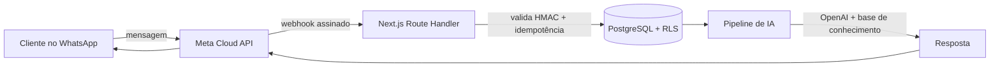

<div align="center">


<br />

# ZapFlow AI

### Atendimento no WhatsApp com IA para pequenos negócios

**Um micro SaaS multi-tenant que responde, qualifica e organiza conversas automaticamente — sem equipe dedicada e sem robôs sob medida.**

<sub>POC real de arquitetura: produto funcional + engenharia de contexto aplicada (Spec-Driven Development, agentes e RLS-first).</sub>

<br />


</div>

---

## O problema

Salões de beleza e clínicas de estética perdem clientes todos os dias por um motivo simples: **ninguém responde o WhatsApp a tempo**. A recepção está atendendo presencialmente, a demanda chega fora do horário comercial e cada conversa esquecida é um agendamento que não aconteceu.

Ferramentas genéricas de chatbot não resolvem: são rígidas, não conhecem o negócio, não isolam dados entre empresas e exigem um projeto de integração para cada cliente.

## A solução

O ZapFlow AI é uma **camada de atendimento inteligente** conectada ao WhatsApp oficial (Meta Cloud API):

| Dor do negócio | Como o ZapFlow resolve |
|---|---|
| Mensagens sem resposta | Recepção automática de webhooks e envio pela API oficial |
| Atendimento genérico | IA com base de conhecimento do próprio negócio |
| Uma instância por cliente | **Multi-tenant nativo** com isolamento por RLS no PostgreSQL |
| Histórico perdido | Conversas, contatos e mensagens persistidos e idempotentes |
| Time sem controle | Organizações, membros, papéis e convites integrados |

> O produto nasce multi-tenant **desde a primeira migration** — não é um retrofit de segurança.

---

## Destaques de arquitetura

### 🛡️ Isolamento multi-tenant por RLS

O frontend **nunca escolhe** o `organization_id`. O servidor valida a associação e o PostgreSQL aplica as políticas via funções `security definer` (`is_org_member`, `is_org_admin`, `current_organization_id`). FKs compostas `(id, organization_id)` garantem integridade entre tenants no nível do schema.

### 🔐 Segredos e integrações somente no servidor

Meta e OpenAI vivem exclusivamente em `src/server/integrations/` (padrão adapter). Nenhuma credencial chega ao cliente, e o cliente administrativo que ignora RLS é isolado com `server-only` e uso restrito a webhooks, jobs e convites.

### 🧠 Engenharia de contexto como prática de engenharia

O repositório não guarda só código — guarda **contexto executável**:

- **`AGENTS.md`** — contrato de arquitetura lido por humanos e agentes.
- **OpenSpec** — toda mudança relevante nasce em `openspec/changes/` (propose → apply → archive), com specs versionadas em `openspec/specs/`.
- **Skills, tools e MCP** — capacidades declaradas e reutilizáveis, em vez de prompts soltos.
- **Spec-Driven Development** — a decisão vira especificação, a especificação vira tarefa, a tarefa vira código verificável.

> *Contexto relevante, não contexto infinito.* — o princípio que guia tanto o produto (IA com a base de conhecimento certa) quanto o desenvolvimento (agentes com o contexto certo).

### ✅ Verificação em vez de confiança

Testes de integração executam queries reais contra o Supabase local para provar o isolamento entre tenants. TypeScript estrito, validação Zod em todas as entradas e `typecheck`/`lint` no fluxo de desenvolvimento.

---

## Como funciona



1. A Meta entrega o evento no webhook, assinado com `X-Hub-Signature-256`.
2. O servidor valida a assinatura e identifica a organização pelo `phone_number_id` registrado — **nunca pelo corpo da requisição**.
3. A mensagem é persistida com `external_message_id` como chave de idempotência.
4. A IA responde com o contexto do negócio e o histórico da conversa.
5. A resposta volta pela API oficial, com status rastreável.

*(Fluxo dos Épicos 4–5; a fundação, autenticação, onboarding, dashboard e membros já estão implementados.)*

---

## Stack

| Camada | Tecnologia |
|---|---|
| Frontend | Next.js **16** (App Router) + React 19 + TypeScript + Tailwind v4 |
| Backend | Next.js Route Handlers / Server Actions |
| Banco | Supabase PostgreSQL (RLS multi-tenant) |
| Autenticação | Supabase Auth (SSR via `@supabase/ssr`) |
| Validação | Zod (ambiente + entradas) |
| WhatsApp | Meta Cloud API (Épico 4) |
| IA | OpenAI API (Épico 5) |
| Testes | Vitest + integração contra Supabase local |
| Specs | OpenSpec (`openspec/`) |

---

## Começando

### Pré-requisitos

- Node.js **22.12+** (projeto usa 24.x)
- npm 10+
- Docker (para o Supabase local) — opcional nesta fase
- OpenSpec CLI (opcional): `irm https://openspec.dev/cli/install.ps1 | iex`

### Setup

```bash
# 1. Instalar dependências
npm install

# 2. Configurar ambiente
cp .env.example .env.local   # preencha as variáveis NEXT_PUBLIC_*

# 3. Rodar a aplicação
npm run dev
```

Aplicação em `http://localhost:3000` · Health check em `http://localhost:3000/api/health`.

### Banco de dados (Supabase local)

```bash
npm run db:start    # sobe o Supabase local (requer Docker)
npm run db:reset    # aplica as migrations 001 → 005
npm run db:types    # regera src/types/database.ts após 'supabase link'
```

### Testes de autorização (RLS)

Os testes de integração em `tests/integration/` verificam o isolamento multi-tenant executando queries reais contra o Supabase local.

```bash
# 1. Suba o Supabase local (Docker)
npm run db:start

# 2. Aplique as migrations (zera o banco)
npm run db:reset

# 3. Obtenha as chaves locais e exporte-as para o shell atual
npx supabase status -o env
# PowerShell:
#   $env:SUPABASE_LOCAL_ANON_KEY = "..."
#   $env:SUPABASE_LOCAL_SERVICE_ROLE_KEY = "..."

# 4. Rode os testes
npm run test
```

Os testes usam um **seed determinístico** (2 usuários, 2 organizações) criado via `createAdminClient` — usado exclusivamente em `tests/`, nunca em código de produção.

### E-mails transacionais em desenvolvimento (Mailpit)

Com o Supabase local de pé, o CLI captura todos os e-mails transacionais (confirmação de cadastro, recuperação de senha e **convite de membro**) no Mailpit. Nada é enviado para o endereço real:

- **Mailpit UI/API:** <http://127.0.0.1:54324> (`/api/v1/messages`)
- **Supabase Studio:** <http://127.0.0.1:54323>

Fluxo E2E manual: registrar em `/register` → abrir o Mailpit e clicar no link de confirmação → login em `/login` → criar a empresa em `/onboarding` → dashboard em `/dashboard`.

Fluxo de convite: `/settings/members/new` → o e-mail chega ao Mailpit → o link abre `/auth/confirm`, que troca o token por sessão e leva a `/auth/reset` para o convidado definir a senha.

> O template do convite está em `supabase/templates/invite.html` e usa
> `{{ .SiteURL }}/auth/confirm?token_hash=...&type=invite&next=/auth/reset`.
> As URLs permitidas ficam em `[auth]` no `supabase/config.toml`.

---

## Variáveis de ambiente

Validadas com Zod em `src/lib/env.ts` (fail-fast). Veja [`.env.example`](./.env.example).

- **Públicas** (`NEXT_PUBLIC_*`): `SUPABASE_URL`, `SUPABASE_ANON_KEY`, `APP_URL`
- **Server-only**: `SUPABASE_SERVICE_ROLE_KEY` (ignora RLS — uso restrito), `OPENAI_API_KEY`, `WHATSAPP_*`

`SUPABASE_SERVICE_ROLE_KEY` é **obrigatória para convidar membros**: o fluxo usa `auth.admin.inviteUserByEmail`. Sem ela, `/settings/members/new` retorna erro de convite indisponível. A chave local sai de `npx supabase status`.

### SMTP de produção (convites e recuperação de senha)

O SMTP embutido do Supabase é limitado e não serve para produção. Use um provedor transacional (Resend, Brevo, MailerSend, SMTP2GO, Elastic Email etc.) e configure no **Dashboard do Supabase**:

1. **Authentication → Emails → SMTP Settings**: host, porta `587`, usuário, senha e remetente verificado (`no-reply@seudominio.com`).
2. **Authentication → Rate Limits**: aumentar `email_sent` (o padrão local é baixo; a UI mostra erro específico ao atingir o limite).
3. **Authentication → URL Configuration**: `Site URL` = URL pública do app e `Redirect URLs` com `https://app.seudominio.com/**`.
4. **Authentication → Email Templates → Invite**: usar o conteúdo de `supabase/templates/invite.html`, apontando para `{{ .SiteURL }}/auth/confirm?token_hash={{ .TokenHash }}&type=invite&next=/auth/reset`.
5. Configurar **SPF/DKIM** do domínio no DNS (registros fornecidos pelo provedor).

> O `supabase/config.toml` (SMTP, `site_url`, redirects e templates) vale apenas para o ambiente local. Em produção tudo isso é configurado no Dashboard.

---

## Estrutura

```
src/
├── app/                 # App Router: páginas, layouts, route handlers, error boundaries
├── components/          # ui, layout, dashboard, conversations, forms
├── features/            # módulos de produto (organizations, contacts, whatsapp, ai, ...)
├── lib/                 # supabase/, env.ts, errors.ts, auth/, security/, validation/, utils/
├── server/              # services/, repositories/, integrations/{whatsapp,openai}, jobs/
└── types/               # database.ts (tipos do banco)
supabase/migrations/     # schema versionado (001 inicial … 005 CRUD de membros)
openspec/                # specs e changes (Spec-Driven Development)
docs/                    # architecture, database, security
```

## Documentação

| Documento | Conteúdo |
|---|---|
| [`docs/architecture.md`](docs/architecture.md) | Decisões, camadas e fluxo de requisições |
| [`docs/database.md`](docs/database.md) | Modelo de dados, FKs compostas e políticas RLS |
| [`docs/security.md`](docs/security.md) | Modelo de ameaças e pendências pré-produção |
| [`openspec/specs/`](openspec/specs/) | Especificações por domínio (auth, organizations, members, dashboard…) |
| [`AGENTS.md`](AGENTS.md) | Contrato de arquitetura para humanos e agentes |
| [`especificacao-tecnica-MVP.md`](../especificacao-tecnica-MVP.md) | Especificação de referência do MVP |

---

## Convenções de engenharia

- **RLS-first:** o frontend nunca escolhe `organization_id` livremente; o servidor valida a associação e o PostgreSQL aplica a política.
- **Sem credenciais no cliente:** integrações externas (Meta, OpenAI) só no servidor.
- **Sem `any`** sem justificativa comentada; toda entrada passa por Zod.
- **Spec-driven:** mudanças relevantes seguem o fluxo OpenSpec (`openspec/changes/` → `archive/`).
- **Contexto é código:** `AGENTS.md`, specs, skills e tools evoluem junto com o produto.

## Roadmap

| Épico | Escopo | Status |
|---|---|---|
| 1 — Fundação | Estrutura, Supabase SSR, env, erros, docs | ✅ Concluído |
| 2 — Auth & multi-tenant | Login, onboarding via RPC, RLS validado | ✅ Concluído |
| 3 — Dashboard | Layout, indicadores, empresa, membros (CRUD + convite) | ✅ Concluído |
| 4 — WhatsApp | Webhook, recepção, envio, status | ⬜ |
| 5 — IA | Adaptador OpenAI, conhecimento, respostas | ⬜ |
| 6 — Comercialização | Landing, planos, limites, pagamentos | ⬜ |

---

<div align="center">

**ZapFlow AI** · da mensagem à conversa resolvida.

<sub>POC construída com Next.js 16, Supabase, OpenAI e uma dose saudável de engenharia de contexto.</sub>

</div>
